<p align="center">
  
</p>

# 💧 Water ATM: Roadmap

> **Goal:** Kenyans can order 20L of clean water from a nearby water ATM shop, pay with M-Pesa, earn points, and get it delivered. They can order on **WhatsApp** or in a **mobile app** (Android + iPhone).
>
> **Pilot target:** 1 partner shop, 30–50 real customers, real M-Pesa payments.

---

## Contents

1. [The big idea: one brain, two doors](#1-the-big-idea-one-brain-two-doors)
2. [Brand & theme](#2-brand--theme)
3. [Tech stack](#3-tech-stack)
4. [Architecture](#4-architecture)
5. [How an order works](#5-how-an-order-works)
6. [WhatsApp bot flow](#6-whatsapp-bot-flow)
7. [App screens](#7-app-screens)
8. [Data model](#8-data-model)
9. [Timeline](#9-timeline)
10. [Phases & checklists](#10-phases--checklists)
11. [Things only you can do](#11-things-only-you-can-do)
12. [Risks](#12-risks)
13. [How we'll know the pilot worked](#13-how-well-know-the-pilot-worked)

---

## 1. The big idea: one brain, two doors

The WhatsApp bot and the app are just two **doors** into the same **brain** (the backend).
All the real logic lives in the backend and is written **once**: orders, payments, points, partners, schedules.
That's why we can build the bot and the app at the same time without doubling the work.

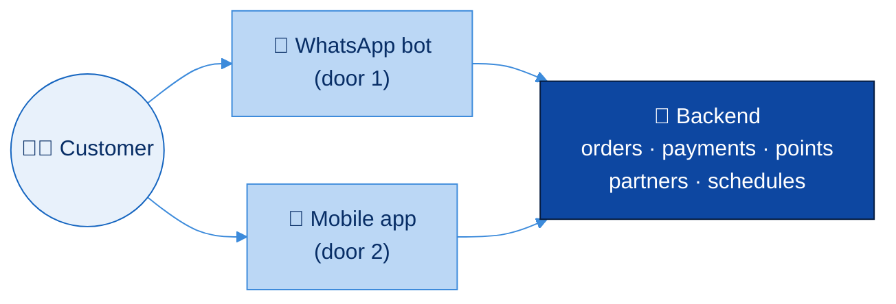

<p align="center">
  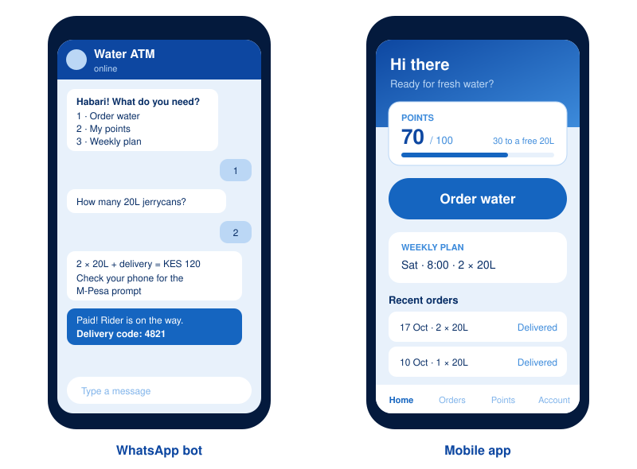
  <br/><sub>Early mockups. Real screens will change.</sub>
</p>

---

## 2. Brand & theme

**Monochrome blue: water, trust, clean.** Every screen, bot message image and admin page uses only these shades (plus white).

<p align="center">
  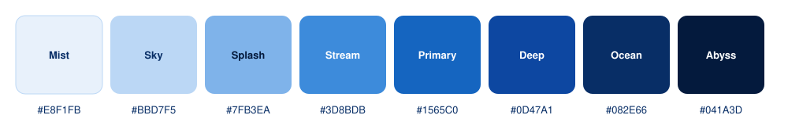
</p>

| Token | Hex | Use it for |
|---|---|---|
| Mist | `#E8F1FB` | App background, light cards |
| Sky | `#BBD7F5` | Borders, customer chat bubbles, disabled |
| Splash | `#7FB3EA` | Hints, inactive icons |
| Stream | `#3D8BDB` | Labels, links, secondary buttons |
| **Primary** | `#1565C0` | Main buttons, active tab, progress bars |
| Deep | `#0D47A1` | Headers, top bars |
| Ocean | `#082E66` | Main text |
| Abyss | `#041A3D` | Dark mode background, splash screen |

**Rules:** no other colors. Success, warning and error states use icons and words (✅ ⚠️ ❌), not green/yellow/red. The logo is a single water drop 💧.

---

## 3. Tech stack

| Part | Choice | Why |
|---|---|---|
| Backend | **Java + Spring Boot**, hexagonal architecture | Typed, solid for money logic, IntelliJ already set up |
| Database | **PostgreSQL** + Flyway migrations | Reliable; migrations keep DB changes tracked in git |
| Mobile app | **React Native + Expo** (TypeScript) | One codebase for Android (most Kenyan customers) **and** iPhone (your test phone). Test instantly with Expo Go, no Mac needed; cloud builds for the stores |
| WhatsApp | **WhatsApp Cloud API** (Meta) | Official, free tier for customer-started chats |
| Payments | **Safaricom Daraja: M-Pesa STK Push** | The PIN prompt pops up on the customer's phone |
| App login | Phone number + OTP sent **via WhatsApp** (SMS fallback) | Reuses the bot, no passwords |
| Push notifications | Expo Notifications (uses Firebase/Apple push underneath) | Free |
| Maps / location | `react-native-maps` (app), shared location pin (bot) | Customers drop a pin instead of typing addresses |
| Admin page | Thymeleaf pages inside the Spring Boot app | No separate frontend project to maintain |
| Scheduled jobs | Spring `@Scheduled` | Weekly plan reminders, payment timeouts |
| Local dev | Docker Compose (Postgres) + a tunnel (ngrok / cloudflared) | WhatsApp and M-Pesa need a public URL to call us back |
| CI | GitHub Actions | Runs tests on every push |
| Hosting | Decide in Phase 6 (small VPS or Railway/Render) | Cheap is fine for a pilot |

### Repo layout

```
water-ATM/
├── backend/                      ☕ Spring Boot, hexagonal architecture
│   ├── compose.yaml              local Postgres
│   └── src/main/java/ke/wateratm/
│       ├── domain/               💧 business rules, plain Java
│       ├── application/
│       │   ├── port/in/          use cases (place order, mark paid...)
│       │   ├── port/out/         what we need (storage, M-Pesa, WhatsApp...)
│       │   └── service/
│       ├── adapter/
│       │   ├── in/whatsapp/      (Phase 3a) bot webhook
│       │   ├── in/web/           ✅ M-Pesa callback + orders API (login in Phase 3b)
│       │   ├── in/scheduler/     ✅ payment/order expiry
│       │   ├── in/admin/         (Phase 6) admin pages
│       │   ├── out/persistence/  ✅ Postgres
│       │   ├── out/mpesa/        ✅ Daraja
│       │   └── out/whatsapp/     (Phase 3a) sending messages
│       └── config/               wiring + transactions
├── mobile/                       📱 customer app (Phase 3b)
├── docs/                         📄 SETUP.md, images
└── ROADMAP.md
```

---

## 4. Architecture

The backend uses **hexagonal architecture** (ports & adapters). The business rules sit in the middle and know nothing
about WhatsApp, M-Pesa or Postgres. Everything outside plugs in through a **port** (an interface) via an **adapter**.
That means we can swap or add a door (bot, app, admin) or a provider without touching the rules. It also means the
rules can be tested in milliseconds with no database. `HexagonalArchitectureTest` fails the build if a layer
reaches outward.

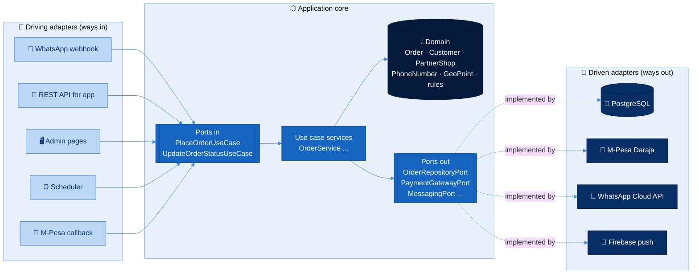

### Dependency rule

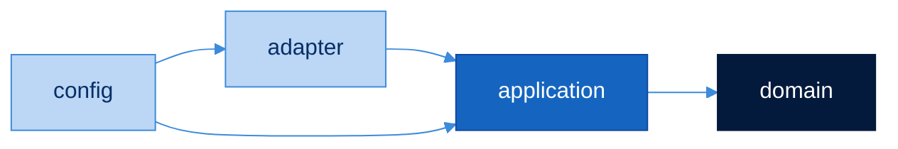

Arrows only point **inward**. The domain depends on nothing but Java.

### Who talks to whom (outside world)

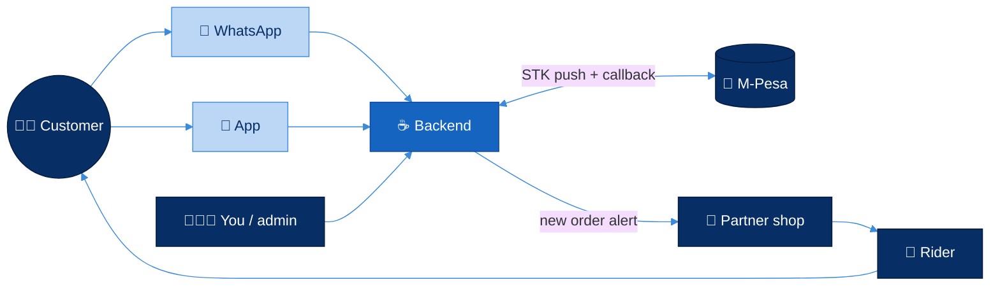

---

## 5. How an order works

The same flow happens whether the customer orders on WhatsApp or in the app.

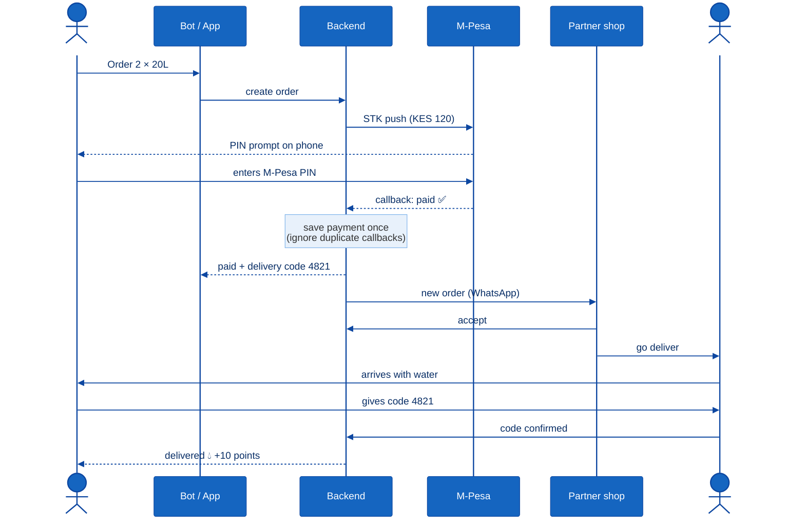

### Order status

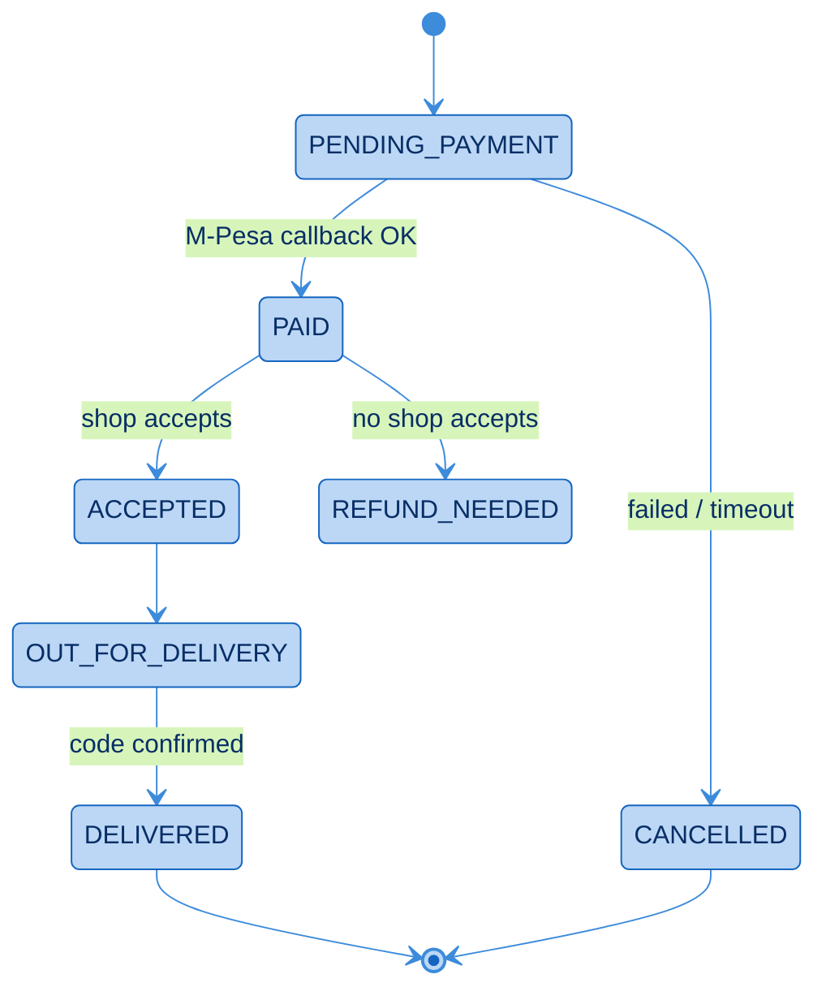

---

## 6. WhatsApp bot flow

Each phone number has a **conversation state** saved in the database, so the bot remembers where the customer is in the chat.

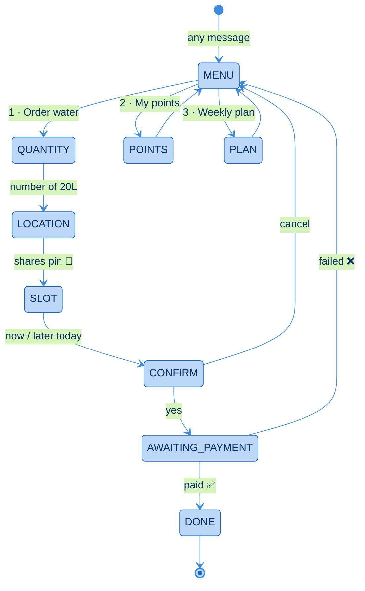

---

## 7. App screens

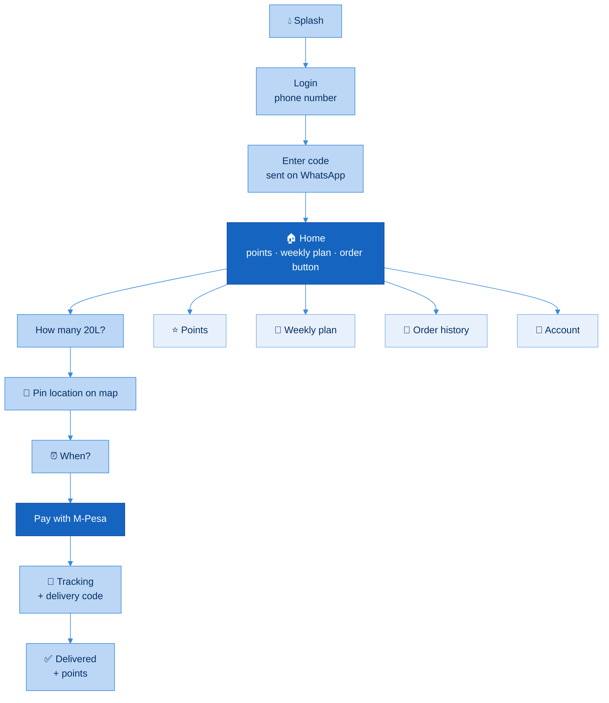

---

## 8. Data model

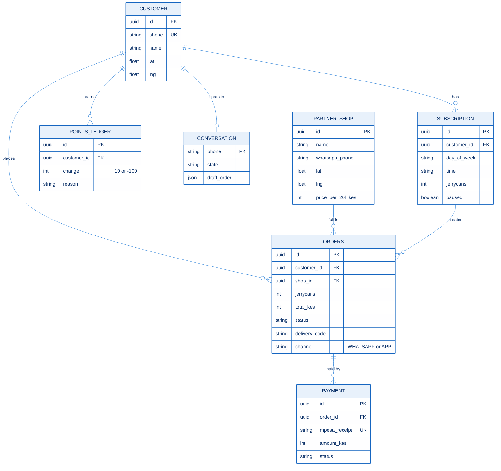

> **Points are a ledger, not a number.** We never overwrite a balance. We add rows (+10, −100) and the balance is the sum. That way points can always be audited and never silently disappear.

---

## 9. Timeline

Starting **Mon 26 Oct 2026**. The bot and app tracks run **in parallel** once the backend foundation exists.
Paperwork runs alongside from day one, because **M-Pesa go-live is the slowest step and the code is not.**

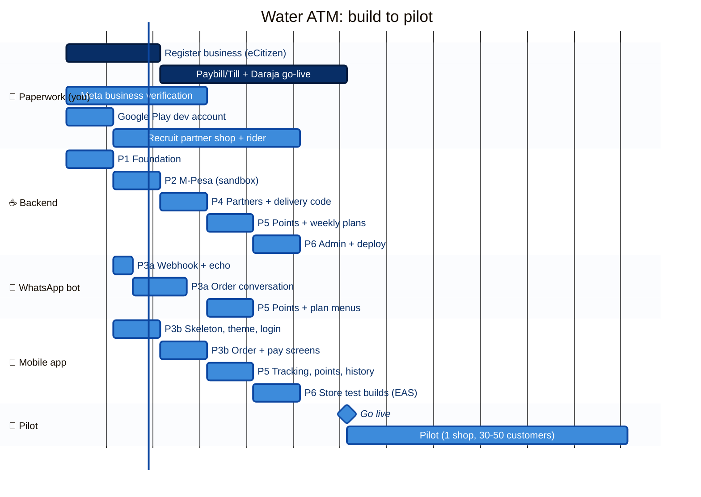

> The pilot date depends on **Paybill + Daraja go-live**. If paperwork is late, we keep testing in sandbox and with friends until it's ready.

---

## 10. Phases & checklists

**Who:** 🧑🏾 = you  ·  🤖 = Claude (code)  ·  🤝 = together

### Phase 0: Kick-off *(this week)*
- [x] 🧑🏾 Create a **Daraja developer account** (sandbox, free): developer.safaricom.co.ke
- [ ] 🧑🏾 Create a **Meta developer account** + WhatsApp Cloud API test number
- [ ] 🧑🏾 Start **business registration** + **Paybill/Till** application (see [§11](#11-things-only-you-can-do))
- [ ] 🧑🏾 Install Docker + **Expo Go** on your iPhone (Android Studio optional, for an Android emulator)
- [x] 🤝 App choice: React Native + Expo (test on your iPhone with Expo Go)
- [x] 🤖 Roadmap (this file)

### Phase 1: Backend foundation *(week 1)* ✅ code done
- [x] 🤖 Spring Boot 4 project in `backend/`, hexagonal architecture, Docker Compose with Postgres
- [x] 🤖 Flyway migration for all tables in [§8](#8-data-model)
- [x] 🤖 Order domain + use cases (place order, paid, accept, out for delivery, confirm code, refund) + tests
- [x] 🤖 ArchUnit test that enforces the hexagon rules
- [x] 🤖 `/actuator/health` endpoint, GitHub Actions running tests
- [ ] 🤝 You run it locally following [`docs/SETUP.md`](docs/SETUP.md)

### Phase 2: M-Pesa sandbox *(week 2)* ✅ code done
- [x] 🤖 Daraja OAuth token (cached) + STK Push request, as a `PaymentGatewayPort` adapter
- [x] 🤖 Callback endpoint that is **idempotent** (same callback twice = paid once), protected by a secret URL
- [x] 🤖 Row locking so a double tap or two callbacks at once can't double-pay
- [x] 🤖 Timeout job: no callback in 5 min → ask Safaricom; unpaid after 30 min → order cancelled
- [x] 🤖 Safety: wrong amount → held for review; money arriving after cancel → flagged for refund
- [x] 🤖 Basic orders API (`POST /api/orders`, `POST /api/orders/{id}/payment`, `GET /api/orders/{id}`)
- [x] 🤖 Keys in a private `backend/.env` file + cloudflared tunnel installed
- [x] 🤝 First real sandbox test (21 Oct): Safaricom accepted the STK push; no callback came for the
      unanswered prompt (sandbox result 1037 "No response from user"); expiry job closed it after 5 min
- [x] 🤖 **Before expiring, ask Safaricom (STK Query API)**: a lost "paid" callback can no longer cancel a paid order.
      Still processing / M-Pesa unreachable → ask again every minute, give up only after 1 hour
- [ ] 🤝 Test with a real Safaricom number (PIN prompt on a phone)

### Phase 3a: WhatsApp bot *(weeks 2–3, parallel)*
- [ ] 🤖 Webhook verify + echo bot
- [ ] 🤖 Conversation state machine ([§6](#6-whatsapp-bot-flow))
- [ ] 🤖 Location pin → nearest partner shop
- [ ] 🤖 Hook into `OrderService` + M-Pesa
- [ ] 🤝 You order water from your own phone (sandbox money)

### Phase 3b: Mobile app (Expo) *(weeks 2–4, parallel)*
- [ ] 🤖 App project in `mobile/`, blue theme from [§2](#2-brand--theme)
- [ ] 🤖 REST API in backend for the app + login with WhatsApp OTP
- [ ] 🤖 Screens: Home → Quantity → Map pin → Time → Pay → Tracking
- [ ] 🤝 You open it on your iPhone with Expo Go and place a sandbox order

### Phase 4: Partners & delivery *(week 3)*
- [ ] 🤖 New order → WhatsApp message to the shop with **Accept** button
- [ ] 🤖 4-digit delivery code; rider confirms by replying with the code
- [ ] 🤖 No shop accepts in 10 min → flag for refund + alert you

### Phase 5: Points & weekly plans *(week 4)*
- [ ] 🤖 Points ledger: +10 per 20L delivered, 100 points = free 20L
- [ ] 🤖 Weekly plan: day before → "Confirm / Skip / Pause" message
- [ ] 🤖 Points + plan menus in the bot, screens in the app
- [ ] 🤖 Push notifications in the app (order accepted, on the way, delivered)

### Phase 6: Admin, hardening, deploy *(week 5)*
- [ ] 🤖 Admin pages: orders today, payments, shops, customers, refunds
- [ ] 🤖 Logging, error alerts, daily DB backup
- [ ] 🤝 Pick hosting + deploy; switch Daraja + WhatsApp to **production**
- [ ] 🧑🏾 Build with EAS; upload to **Play Store internal testing** (+ TestFlight if we want iPhone users; Apple dev account ~$99/yr)
- [ ] 🤝 Full end-to-end test with **real money** (small amounts)

### Phase 7: Pilot *(6 weeks)*
- [ ] 🧑🏾 Onboard 1 shop + rider(s); print a QR poster for the shop ("Order on WhatsApp")
- [ ] 🧑🏾 Get the first 30–50 customers (neighbours, the shop's regulars, estate WhatsApp groups)
- [ ] 🤝 Weekly review of the numbers in [§13](#13-how-well-know-the-pilot-worked); fix what hurts
- [ ] 🧑🏾 Collect quotes + numbers for pitching to incubators and grants

---

## 11. Things only you can do

Code can't do these steps, and they take the longest, so **start them now**.

| What | Why | Notes |
|---|---|---|
| 🏢 Register a business | Safaricom needs one for a Paybill/Till | Kenya's eCitizen Business Registration Service. Check exact requirements; it can be done online |
| 📲 Paybill or Till number | Needed to receive **real** M-Pesa money | Apply via Safaricom; then request Daraja **go-live** for that shortcode |
| ✅ Meta business verification | Needed for the bot to message real customers at scale | Done in Meta Business Manager |
| 🛒 Google Play developer account | Publishing the app | One-time fee (around $25) |
| 🏪 Partner shop + rider | Someone has to carry the water! | You live abroad, so you'll need a trusted person on the ground |
| 📱 Testing on real phones | Cheap Androids + real Safaricom lines behave differently | Same trusted person can help |

---

## 12. Risks

| Risk | Impact | What we do |
|---|---|---|
| M-Pesa go-live is slow | Pilot delayed | Start paperwork in Phase 0; keep testing in sandbox |
| Customer paid but water never came | Lost trust | Refund-needed status + alert to you + admin refund page |
| Duplicate M-Pesa callbacks | Charged/credited twice | Unique `mpesa_receipt`; idempotent handler |
| WhatsApp message costs grow | Eats margin | Reminders only for weekly-plan customers; push app users instead |
| Few people download the app | App unused | That's fine: the bot carries the pilot; the app is for repeat users |
| You can't read the code when it breaks | Stuck in production | I explain every phase; `docs/` has plain-English guides; tests on money logic |
| Shop is offline/out of water | Orders stuck | 10-minute accept timeout; later: multiple shops per area |

---

## 13. How we'll know the pilot worked

| Metric | Target |
|---|---|
| Active customers | 30–50 |
| Customers who order **again** within 2 weeks | > 50% |
| M-Pesa payment success rate | > 90% |
| Order → delivered time | < 60 min |
| Orders on weekly plans | > 20% |
| Paid-but-not-delivered | 0 unresolved |

If people come back without being pushed, we have something worth pitching. 💧
